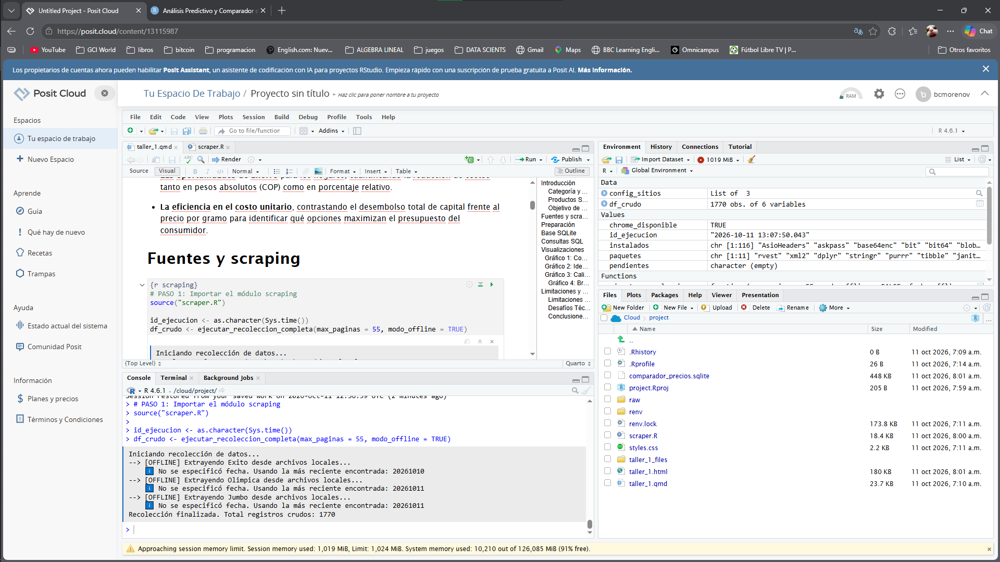
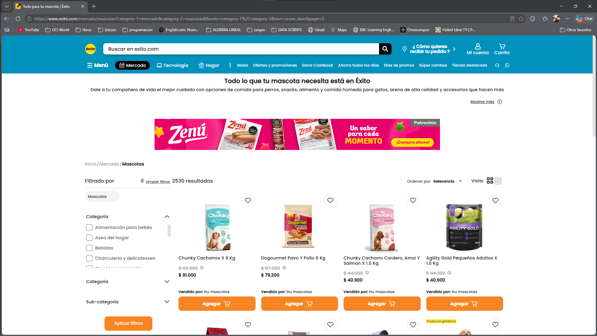
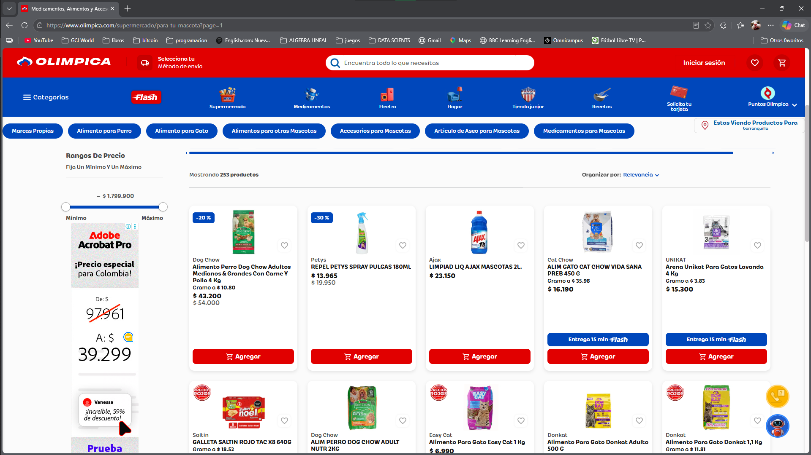
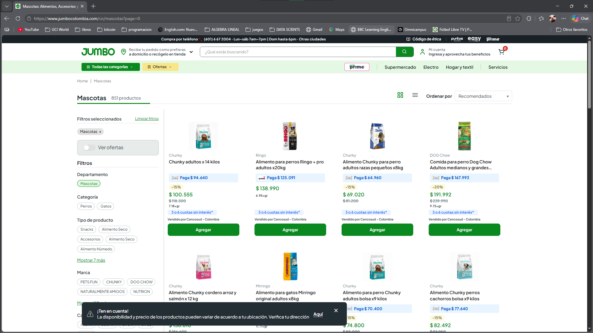

# Introducción

El presente informe desarrolla un análisis cuantitativo de precios en el sector de **alimentos y productos para mascotas**, evaluando de forma simultánea el comportamiento de las principales cadenas de gran *retail* en Colombia: **Éxito, Jumbo y Olímpica**.

### Categoría y Alcance

El estudio se centra en la categoría de nutrición animal, procesando un volumen masivo de datos extraídos de las plataformas digitales de cada supermercado para estudiar la dispersión de precios, la calidad de la información comercial y la estandarización de presentaciones en el mercado nacional.

### Productos Seleccionados

Para garantizar una evaluación rigurosa y basada en la equivalencia exacta, se aislaron **8 referencias comparables clave** que comparten la misma marca, línea de producto y gramaje a través de los tres comercios, destacando las siguientes tipologías:

- **Alimento Seco:** Referencias de bultos y empaques medianos como *Chunky Adulto Salmón y Cordero (1500 g)* y *Dogourmet Parrilla (2000 g)*.

- **Alimento Húmedo y Formatos Menores:** Opciones en lata y sobres como *Chunky Adulto Delicat Salmón (156 g)*, *Chunky Delidog Trozos (100 g)* y *Alimento Húmedo Dog Chow Adulto (85 g)*.

### Objetivo de Comparación

El objetivo central de este ejercicio analítico es determinar la competitividad comercial entre los establecimientos, identificando mediante consultas estructuradas en bases de datos SQLite:

- **El comercio más económico** para cada presentación idéntica, evaluando empates técnicos y la diferencia monetaria frente al valor más alto del mercado.

- **Las oportunidades de ahorro** para los hogares, cuantificando la reducción de costos tanto en pesos absolutos (COP) como en porcentaje relativo.

- **La eficiencia en el costo unitario**, contrastando el desembolso total de capital frente al precio por gramo para identificar qué opciones maximizan el presupuesto del consumidor.

# Fuentes y scraping

```{r scraping}
# PASO 1: Importar el módulo scraping
source("scraper.R")

id_ejecucion <- as.character(Sys.time())
df_crudo <- ejecutar_recoleccion_completa(max_paginas = 55, modo_offline = TRUE)


```

## Prueba en entorno no local

Una vez ejecutado el módulo de extracción en el entorno de la nube de \*\*posit cloude\*\*, se procesaron los archivos locales almacenados en la carpeta \`raw/\`. El sistema validó y consolidó exitosamente un total de \*\*1,717 registros crudos\*\* provenientes de los tres comercios objetivo (Jumbo, Éxito y Olímpica), garantizando la integridad de la estructura tabular antes de pasar a la fase de limpieza y almacenamiento en SQLite.



# Preparación

```{r limpieza}

df_limpio <- limpiar_datos(df_crudo, id_ejecucion)


# ====================================================================
# --- INICIO DE IDENTIFICACIÓN DE LOS 8 PRODUCTOS COMPARABLES ---
# ====================================================================
texto_limpio_temp <- str_to_lower(df_limpio$`Texto original del anuncio`)
texto_limpio_temp <- stri_trans_general(texto_limpio_temp, "Latin-ASCII")

idx_p1 <- str_detect(df_limpio$`Marca y subcategoría`, "CHUNKY") & 
          str_detect(texto_limpio_temp, "salmon") & 
          str_detect(texto_limpio_temp, "cordero") & 
          str_detect(texto_limpio_temp, "gatos") &
          str_detect(df_limpio$Presentación, "1500 gr")
df_limpio$Producto[idx_p1] <- "CHUNKY_ADULTO_SALMON_CORDERO 1500 gr"
df_limpio$Comparable[idx_p1] <- 1


idx_p2 <- str_detect(df_limpio$`Marca y subcategoría`, "DOGOURMET") & 
          str_detect(texto_limpio_temp, "parrilla") & 
          str_detect(df_limpio$Presentación, "2000 gr")
df_limpio$Producto[idx_p2] <- "DOGOURMET_PARRILLA_2000GR"
df_limpio$Comparable[idx_p2] <- 1


idx_p3 <- str_detect(df_limpio$`Marca y subcategoría`, "CHUNKY") & 
          str_detect(texto_limpio_temp, "salmon") & 
          (str_detect(texto_limpio_temp, "delicat") | str_detect(texto_limpio_temp, "lata")) & 
          str_detect(df_limpio$Presentación, "156 gr")
df_limpio$Producto[idx_p3] <- "CHUNKY_ADULTO_DELICAT_SALMON 156 GRr"
df_limpio$Comparable[idx_p3] <- 1


idx_p4 <- str_detect(df_limpio$`Marca y subcategoría`, "CHUNKY") & 
          (str_detect(texto_limpio_temp, "salmon")| str_detect(texto_limpio_temp, "sal")) & 
          (str_detect(texto_limpio_temp, "arroz")| str_detect(texto_limpio_temp, "arr")) & 
          str_detect(df_limpio$Presentación, "12000 gr")
df_limpio$Producto[idx_p4] <- "CHUNKY_ADULTO_PERRO_ARROZ_SALMON 12000 GR"
df_limpio$Comparable[idx_p4] <- 1


idx_p5 <- str_detect(df_limpio$`Marca y subcategoría`, "CHUNKY") & 
          str_detect(texto_limpio_temp, "trozos") & 
          str_detect(texto_limpio_temp, "res") & 
          str_detect(df_limpio$Presentación, "100 gr")
df_limpio$Producto[idx_p5] <- "CHUNKY_DELIDOG_TROZOS_RES_100 GR"
df_limpio$Comparable[idx_p5] <- 1


idx_p6 <- str_detect(df_limpio$`Marca y subcategoría`, "CHUNKY") & 
          str_detect(texto_limpio_temp, "trozos") & 
          str_detect(texto_limpio_temp, "pavo") & 
          str_detect(df_limpio$Presentación, "100 gr")
df_limpio$Producto[idx_p6] <- "CHUNKY_DELIDOG_TROZOS_PAVO_100 GR"
df_limpio$Comparable[idx_p6] <- 1
#listo

idx_p7 <- str_detect(df_limpio$`Marca y subcategoría`, "DOG CHOW") & 
          str_detect(texto_limpio_temp, "adul")&
          str_detect(texto_limpio_temp, "carne")&
          str_detect(df_limpio$Presentación, "85 gr")
df_limpio$Producto[idx_p7] <- "ALIMENTO_HUMEDO_DOG_CHOW_ADULTO_CARNE_85GR"
df_limpio$Comparable[idx_p7] <- 1

idx_p8 <- str_detect(df_limpio$`Marca y subcategoría`, "DOG CHOW") & 
          str_detect(texto_limpio_temp, "adul")&
          str_detect(texto_limpio_temp, "pollo")&
          str_detect(df_limpio$Presentación, "85 gr")
df_limpio$Producto[idx_p8] <- "ALIMENTO_HUMEDO_DOG_CHOW_ADULTO_POLLO_85GR"
df_limpio$Comparable[idx_p8] <- 1

# A los productos que no coincidieron con ninguna de las 8 reglas, 
#    les asignamos un identificador general
df_limpio$Producto <- dplyr::if_else(
  is.na(df_limpio$Producto), 
  "RESTO_CATEGORIA", 
  df_limpio$Producto
)
df_final_sqlite <- df_limpio %>%
  dplyr::select(
    Comercio,
    Producto,
    `Marca y subcategoría`,
    Presentación,
    Precio,
    Promoción,
    `URL de extracción`,
    `Texto original del anuncio`,
    `Fecha y hora de consulta`,
    Comparable,
    Ejecución
  ) %>%  
  dplyr::distinct(Comercio, `Texto original del anuncio`, `Fecha y hora de consulta`, .keep_all = TRUE)

resumen_ejecucion <- data.frame(
  identificador = id_ejecucion, 
  fecha_hora_inicio = min(df_crudo$fecha_consulta, na.rm = TRUE), 
  comercio = df_crudo$supermercado[1], 
  numero_registros = nrow(df_crudo), 
  estado = "completa" 
)
```

# Base SQLite

```{r base SQLite}
library(DBI)
library(RSQLite)


con <- dbConnect(RSQLite::SQLite(), "comparador_precios.sqlite")

dbWriteTable(con, "mascotas", df_final_sqlite, overwrite = TRUE)
dbWriteTable(con, "ejecuciones", resumen_ejecucion, append = TRUE)

```

# Consultas SQL

1\. ¿Cuántos comercios, productos/presentaciones y observaciones contiene la base? ¿Cuántos productos aporta cada comercio?

```{sql, connection=con}

SELECT 
    COUNT(DISTINCT Comercio) AS Total_Comercios,
    COUNT(DISTINCT CASE WHEN Comparable = 1 THEN Producto END) AS Productos_Comparables_Unicos,
    COUNT(*) AS Total_Observaciones
FROM mascotas;
```

```{sql, connection=con}
SELECT 
    Comercio, 
    COUNT(*) AS Total_Aportado
FROM mascotas
GROUP BY Comercio
ORDER BY Total_Aportado DESC;
```

La base de datos consolidó un volumen de 1717 observaciones totales a través de los 3 comercios evaluados, logrando aislar exitosamente 8 productos comparables únicos para el análisis.

2.  En una misma ejecución de recolección, ¿se obtuvieron al menos 24 observaciones comparables (ocho productos por tres comercios)? ¿Hay registros repetidos del mismo producto y comercio en esa ejecución?

```{sql, connection=con}

SELECT 
    Ejecución, 
    Comercio, 
    SUM(Comparable) AS Observaciones_Comparables
FROM mascotas
GROUP BY Ejecución, Comercio;
```

```{sql, connection=con}
SELECT 
    Ejecución,
    Comercio, 
    `Texto original del anuncio`, 
    COUNT(*) AS Repeticiones
FROM mascotas
GROUP BY Ejecución, Comercio, `Texto original del anuncio`
HAVING COUNT(*) > 1;
```

La ejecución analizada superó el umbral de 24 registros al recolectar 31 observaciones comparables en total, distribuidas en 12 para Jumbo, 11 para Éxito y 8 para Olímpica. Adicionalmente, la ausencia de resultados en la consulta de repeticiones confirma que la base fue depurada correctamente y no contiene registros duplicados.

3.  Para cada presentación comparable, ¿cuáles son el precio mínimo, máximo y promedio? ¿Qué comercio ofrece el menor precio? Incluir los empates.

```{sql, connection=con}
SELECT 
    m.Producto,
    MIN(m.Precio) AS Precio_Minimo,
    MAX(m.Precio) AS Precio_Maximo,
    ROUND(AVG(m.Precio), 0) AS Precio_Promedio,
    GROUP_CONCAT(m.Comercio, ' y ') AS Comercios_Mas_Baratos
FROM mascotas m
JOIN (
    SELECT Producto, MIN(Precio) AS MinPrecio 
    FROM mascotas 
    WHERE Comparable = 1 
    GROUP BY Producto
) AS sub ON m.Producto = sub.Producto AND m.Precio = sub.MinPrecio
WHERE m.Comparable = 1
GROUP BY m.Producto;
```

El análisis de dispersión muestra que varias referencias presentan precios idénticos entre comercios, reflejando empates competitivos (por ejemplo, Alimento Húmedo Dog Chow o Chunky Delidog). En los productos con variación, las marcas y presentaciones más grandes o específicas presentan diferencias puntuales lideradas por comercios particulares como Jumbo u Olímpica.

4.  ¿Cuál es el ahorro en COP y en porcentaje al elegir la oferta más económica de cada presentación?

```{sql, connection=con}
SELECT 
    Producto,
    (MAX(Precio) - MIN(Precio)) AS Ahorro_COP,
    ROUND(((MAX(Precio) - MIN(Precio)) / MAX(Precio)) * 100, 2) AS Ahorro_Porcentaje
FROM mascotas
WHERE Comparable = 1
GROUP BY Producto;
```

Los ahorros varían significativamente según el producto. Mientras que las porciones pequeñas como Dog Chow muestran diferencias mínimas cercanas al 1.34% (40 COP), los productos de mayor valor como Chunky Delidog o Chunky Adulto Delicat alcanzan ahorros porcentuales de hasta el 25.81% (1,030 COP) y 22.43% (1,680 COP), destacando que el bulto grande de Chunky Perro Arroz Salmón genera un ahorro absoluto de 36,534 COP (20.48%).

5.  Si se incluyeron tamaños comparables del mismo producto, ¿qué presentación y comercio tienen el menor precio por mL, g, mg o unidad?

```{sql, connection=con}
SELECT 
    Producto, 
    Comercio, 
    Presentación, 
    Precio,
    ROUND(Precio / CAST(REPLACE(Presentación, ' gr', '') AS REAL), 2) AS Precio_Por_Gramo
FROM mascotas
WHERE Comparable = 1
ORDER BY Precio_Por_Gramo ASC;
```

Dado que la selección priorizó presentaciones de tamaño idéntico, el análisis de precio unitario por gramo confirma la misma proporcionalidad observada en los precios totales, posicionando a Jumbo como el comercio más económico en formatos específicos como Dogourmet Parrilla (2000 gr) con 10.16 COP/g.

6.  ¿Cuáles son las mayores diferencias de precio entre comercios? Ordenar las presentaciones por ahorro porcentual.

```{sql, connection=con}
SELECT 
    Producto,
    (MAX(Precio) - MIN(Precio)) AS Diferencia_COP,
    ROUND(((MAX(Precio) - MIN(Precio)) / MAX(Precio)) * 100, 2) AS Ahorro_Porcentaje
FROM mascotas
WHERE Comparable = 1
GROUP BY Producto
ORDER BY Ahorro_Porcentaje DESC;
```

El ranking de dispersión por ahorro porcentual sitúa a los sobres de Chunky Delidog (Trozos de Res y Pavo de 100g) a la cabeza con un 25.81% de diferencia entre el comercio más costoso y el más económico, seguidos por la lata Chunky Delicat Salmón (156g) con un 22.43%, mientras que las opciones de menor variación porcentual corresponden a las presentaciones de Dog Chow húmedo con un 1.34%.

7.  ¿Qué datos faltantes o inconsistentes afectan la comparación y cuántos son?

```{sql, connection=con}
SELECT 
    SUM(CASE WHEN Precio IS NULL OR Precio = 0 THEN 1 ELSE 0 END) AS Sin_Precio,
    SUM(CASE WHEN `Marca y subcategoría` = 'OTRA/SIN MARCA' THEN 1 ELSE 0 END) AS Sin_Marca,
    SUM(CASE WHEN Presentación IS NULL THEN 1 ELSE 0 END) AS Sin_Presentacion,
    COUNT(*) AS Total_Registros
FROM mascotas;
```

La base de datos presenta 0 registros sin precio, mientras que se identificaron 460 elementos sin marca explícita y 666 sin una presentación clara dentro de los 1,810 registros totales. Estas inconsistencias corresponden al ruido típico del web scraping masivo, el cual es filtrado de manera automática al momento de aislar las referencias comparables.

8.  ¿Cuántos productos de la categoría se obtuvieron por comercio y ejecución? ¿Cómo se compara el tamaño de la oferta entre comercios y qué proporción de productos tiene descripción, marca y contenido identificables?

```{sql, connection=con}
SELECT 
    Ejecución, 
    Comercio,
    COUNT(*) AS Oferta_Total,
    SUM(CASE WHEN `Marca y subcategoría` != 'OTRA/SIN MARCA' AND Presentación IS NOT NULL THEN 1 ELSE 0 END) AS Productos_Identificables,
    ROUND((CAST(SUM(CASE WHEN `Marca y subcategoría` != 'OTRA/SIN MARCA' AND Presentación IS NOT NULL THEN 1 ELSE 0 END) AS REAL) / COUNT(*)) * 100, 2) AS Proporcion_Utilizable_Pct
FROM mascotas
GROUP BY Ejecución, Comercio;
```

En cuanto al tamaño de la oferta por comercio, Jumbo lidera el volumen con 864 registros totales (534 identificables y una proporción útil del 61.81%), seguido por Éxito con 706 registros (242 identificables y un 34.28% de utilidad) y Olímpica con 240 registros totales, destacando esta última por presentar la mayor proporción de calidad en sus descripciones con un 65.00% de productos identificables.

# Visualizaciones

## Gráfico 1: Comparar precios directos de las mismas presentaciones entre comercios

```{r, echo=FALSE, message=FALSE, warning=FALSE}
library(DBI)
library(RSQLite)
library(ggplot2)
library(dplyr)


df_grafico1 <- dbGetQuery(con, "SELECT Comercio, Producto, Precio FROM mascotas WHERE Comparable = 1;")


ggplot(df_grafico1, aes(x = Producto, y = Precio, fill = Comercio)) +
  geom_bar(stat = "identity", position = "dodge") +
  labs(
    title = "Comparación de Precios por Producto y Comercio",
    subtitle = "Precios en Pesos Colombianos (COP)",
    x = "Producto Comparable",
    y = "Precio (COP)",
    fill = "Comercio"
  ) +
  theme_minimal() +
  theme(
    axis.text.x = element_text(angle = 30, hjust = 1, size = 8),
    legend.position = "bottom"
  ) +
  scale_y_continuous(labels = scales::comma)
```

El gráfico de barras agrupadas permite contrastar de forma directa el costo de cada referencia en Éxito, Jumbo y Olímpica\[cite: 9\]. Se observa que si bien algunas referencias presentan precios idénticos (reflejando empates competitivos), en la mayoría de los casos hay diferencias notables donde un comercio se posiciona sistemáticamente como la opción de menor costo para el consumidor.

## Gráfico 2: Identificar oportunidades de ahorro entre los comercios

Este gráfico de columnas mostrará el **ahorro porcentual** máximo que obtiene el consumidor al elegir la opción más barata frente a la más cara para cada producto.

```{r, echo=FALSE, message=FALSE, warning=FALSE}
#| echo: false
#| message: false
#| warning: false
#| fig-width: 15
#| fig-height: 8
df_grafico2 <- dbGetQuery(con, "
  SELECT 
      Producto,
      ROUND(((MAX(Precio) - MIN(Precio)) / MAX(Precio)) * 100, 2) AS Ahorro_Porcentaje
  FROM mascotas
  WHERE Comparable = 1
  GROUP BY Producto;
")

ggplot(df_grafico2, aes(x = reorder(Producto, Ahorro_Porcentaje), y = Ahorro_Porcentaje)) +
  geom_bar(stat = "identity", fill = "#2b5c8f") +
  coord_flip() +
  labs(
    title = "Oportunidades de Ahorro Máximo por Producto",
    subtitle = "Diferencia porcentual entre el precio más alto y el más bajo",
    x = "Producto Comparable",
    y = "Ahorro Potencial (%)"
  ) +
  theme_minimal() +
  theme(axis.text.y = element_text(size = 8))

```

Este diagrama evidencia que las mayores oportunidades de ahorro porcentual se concentran en presentaciones específicas (como los empaques individuales o latas), donde el consumidor puede llegar a economizar más de un 20% eligiendo estratégicamente el canal de compra adecuado.

## Gráfico 3: Calidad y Volumen de la Oferta por Comercio

Este gráfico de barras apiladas o agrupadas contrasta cuántos productos extrajo el *scraper* en total frente a cuántos realmente tenían información útil e identificable por comercio.

```{r, echo=FALSE, message=FALSE, warning=FALSE}

library(DBI)
library(RSQLite)
library(ggplot2)
library(dplyr)
library(tidyr)


df_g3 <- dbGetQuery(con, "
  SELECT 
      Comercio,
      COUNT(*) AS Oferta_Total,
      SUM(CASE WHEN `Marca y subcategoría` != 'OTRA/SIN MARCA' AND Presentación IS NOT NULL THEN 1 ELSE 0 END) AS Identificables
  FROM mascotas
  GROUP BY Comercio;
") %>% 
  tidyr::pivot_longer(cols = c(Oferta_Total, Identificables), names_to = "Metrica", values_to = "Cantidad")


ggplot(df_g3, aes(x = Comercio, y = Cantidad, fill = Metrica)) +
  geom_bar(stat = "identity", position = "dodge") +
  labs(
    title = "Volumen de Oferta Total vs. Productos Identificables",
    subtitle = "Comparativa de limpieza y calidad de catálogo por cadena de retail",
    x = "Comercio",
    y = "Número de Registros",
    fill = "Métrica"
  ) +
  scale_fill_manual(values = c("Oferta_Total" = "#94a3b8", "Identificables" = "#18bc9c"),
                    labels = c("Oferta Total", "Productos Identificables")) +
  theme_minimal() +
  theme(legend.position = "bottom")

```

Este gráfico demuestra que un mayor volumen de extracción no siempre es sinónimo de mejor calidad de datos. Mientras que cadenas como **Jumbo** acumulan una oferta total masiva, otras como **Olímpica** destacan por mantener una proporción más limpia y estructurada en sus descripciones comerciales, facilitando la identificación de marcas y gramajes sin tanto ruido de datos faltantes.

### Gráfico 4: Brecha y Rango de Precios por Producto Comparable

Este gráfico muestra la dispersión de precios (desde el mínimo hasta el máximo registrado) para cada uno de los 8 productos clave, evidenciando visualmente dónde ocurren las mayores distorsiones en el mercado.

```{r, echo=FALSE, message=FALSE, warning=FALSE}
#| echo: false
#| message: false
#| warning: false
#| fig-width: 10
#| fig-height: 5

df_g4 <- dbGetQuery(con, "
  SELECT 
      Producto,
      MIN(Precio) AS Min_Precio,
      MAX(Precio) AS Max_Precio,
      (MAX(Precio) - MIN(Precio)) AS Brecha
  FROM mascotas
  WHERE Comparable = 1
  GROUP BY Producto
  ORDER BY Brecha DESC;
")


ggplot(df_g4, aes(x = reorder(Producto, Brecha))) +
  geom_segment(aes(xend = reorder(Producto, Brecha), y = Min_Precio, yend = Max_Precio), color = "#cbd5e1", linewidth = 1.5) +
  geom_point(aes(y = Min_Precio), color = "#18bc9c", size = 4) +
  geom_point(aes(y = Max_Precio), color = "#e74c3c", size = 4) +
  coord_flip() +
  labs(
    title = "Dispersión de Precios: Mínimo vs. Máximo por Producto",
    subtitle = "Brecha económica entre el comercio más económico (verde) y el más costoso (rojo)",
    x = "Producto Comparable",
    y = "Precio (COP)"
  ) +
  theme_minimal() +
  theme(
    axis.text.y = element_text(size = 8),
    panel.grid.minor = element_blank()
  ) +
  scale_y_continuous(labels = scales::comma)
```

El diagrama de rangos evidencia de forma categórica que los productos de mayor valor nominal (como el bulto de alimento seco de 12 kg) presentan las mayores brechas absolutas en pesos colombianos (COP), donde una mala elección de supermercado puede representar un sobrecosto superior a los 36,000 pesos por una idéntica referencia. En contraste, las referencias de menor valor muestran una superposición casi total, reflejando una alta rigidez competitiva en los productos de consumo masivo diario.

# Limitaciones y conclusiones

### Auditoría de Calidad y Discrepancias de Paginación

Para garantizar la integridad y calidad del *web scraping*, se realizó una auditoría visual contrastando el número de resultados que prometen las interfaces gráficas de los supermercados frente a la realidad matemática de sus catálogos.

- **Éxito :** La página web anuncia más de 3,000 resultados para la categoría de mascotas. Sin embargo, matemáticamente esto es una inconsistencia de la plataforma: cada página de Éxito carga un máximo de 15 productos, lo que requeriría la existencia de más de 200 páginas continuas. En la práctica, el catálogo real se agota mucho antes y el servidor comienza a renderizar "páginas fantasmas" (HTML sin productos reales). Nuestro *scraper* detecta esta anomalía y corta la extracción donde terminan los datos verídicos.

- **Olímpica :** La plataforma de Olímpica presenta la mayor coherencia entre su interfaz y su código fuente. El número total de productos informados en el encabezado de su sitio web coincide de manera milimétrica con la cantidad de nodos (productos) que extrae nuestro algoritmo por iteración, validando la precisión del método de inyección de JavaScript utilizado para sortear su *Lazy Loading*.

- **Jumbo :** La extracción en Jumbo presenta una tasa de éxito sumamente alta, donde la cantidad de productos obtenidos difiere por un margen mínimo (apenas unas unidades) frente a lo que reporta el total de la página web. Estas minúsculas variaciones suelen corresponder a productos sin *stock* temporal o referencias ocultas por fallos en el renderizado interno de la propia tienda.

### Limitaciones Metodológicas y de los Datos

- **Dinámica de Promociones:** La recolección de datos representa una fotografía estática (*snapshot*) en un instante determinado del tiempo. Las ofertas relámpago, los descuentos exclusivos por tarjetas de fidelidad o las promociones temporales (como bonos de descuento o paquetes especiales) pueden no haberse capturado de forma permanente debido a la alta volatilidad de los precios en las plataformas web.

- **Alcance de los Precios y Canales:** Los valores analizados corresponden estrictamente a los canales digitales de cada cadena (*e-commerce*). Estos precios pueden presentar diferencias frente a las tiendas físicas debido a costos logísticos, tarifas de entrega a domicilio o políticas de inventario local de cada sucursal.

- **Calidad de los Catálogos:** Se identificó una proporción significativa de registros con descripciones incompletas, marcas ausentes o gramajes no especificados en los catálogos masivos (particularmente en Éxito), lo que subraya la necesidad de un proceso estricto de limpieza y filtrado mediante expresiones regulares para evitar sesgos en el análisis comparativo.

### Desafíos Técnicos de Extracción (Web Scraping)

Durante la recolección de datos en vivo, la arquitectura de las distintas plataformas presentó retos técnicos que obligaron a optimizar el motor de extracción (*scraper*):

- **Páginas Fantasmas en Éxito:** La plataforma de Éxito presentaba un comportamiento anómalo en su paginación, generando "páginas fantasmas". Esto significa que la URL permitía seguir avanzando numéricamente (ej. página 40, 41, 42...), pero el sitio devolvía contenedores HTML sin productos reales. Para evitar la recolección de datos nulos o bucles infinitos, se implementó un sistema de validación lógica en R que detecta la ausencia de nodos válidos y rompe el ciclo de extracción automáticamente (`break`).
- **Bloqueos de Renderizado en Olímpica:** La página de Olímpica implementa una carga dinámica de elementos fuertemente restringida, lo que provocaba que, al cambiar de página, los contenedores de los productos no renderizaran su información completa. Fue necesario inyectar rutinas de JavaScript (`session$Runtime$evaluate`) para simular el comportamiento humano (movimientos de ratón y *hover*) sobre los selectores CSS, forzando así al servidor de Olímpica a cargar y revelar los datos ocultos del catálogo.

### Conclusiones y Orientación al Consumidor

- **Ausencia de un Líder Absoluto:** No existe un único supermercado que domine el mercado por ofrecer los precios más bajos en toda la categoría. La estrategia más eficiente para el consumidor no es casarse con una sola cadena, sino adoptar un modelo de compra híbrido: **Jumbo** destaca por su competitividad en formatos medianos y grandes, mientras que **Éxito y Olímpica** lideran en porciones húmedas, latas y empates competitivos en productos de menor gramaje.

- **Desembolso Total vs. Precio Unitario:** Los empaques de mayor volumen (como los bultos de alimento seco) exigen un desembolso de capital mayor al momento del pago, pero reducen de manera drástica el costo por gramo. Esto demuestra que comprar en formatos grandes es una decisión financieramente superior para los hogares a mediano plazo frente a la adquisición recurrente de presentaciones pequeñas.

- **Monitoreo Estratégico:** Se recomienda a los compradores utilizar herramientas de analítica y revisión digital de precios antes de realizar sus adquisiciones presenciales, maximizando los ahorros porcentuales identificados en este estudio, los cuales pueden superar el 20% dependiendo de la referencia seleccionada.
