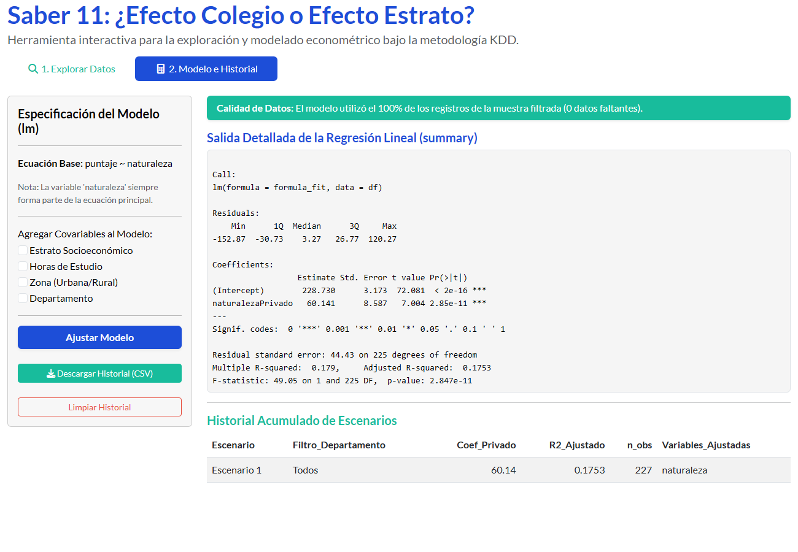
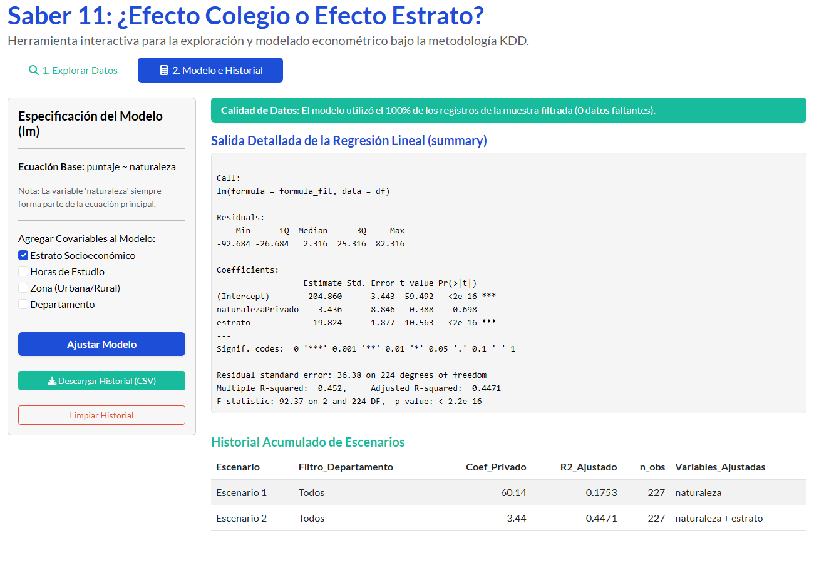
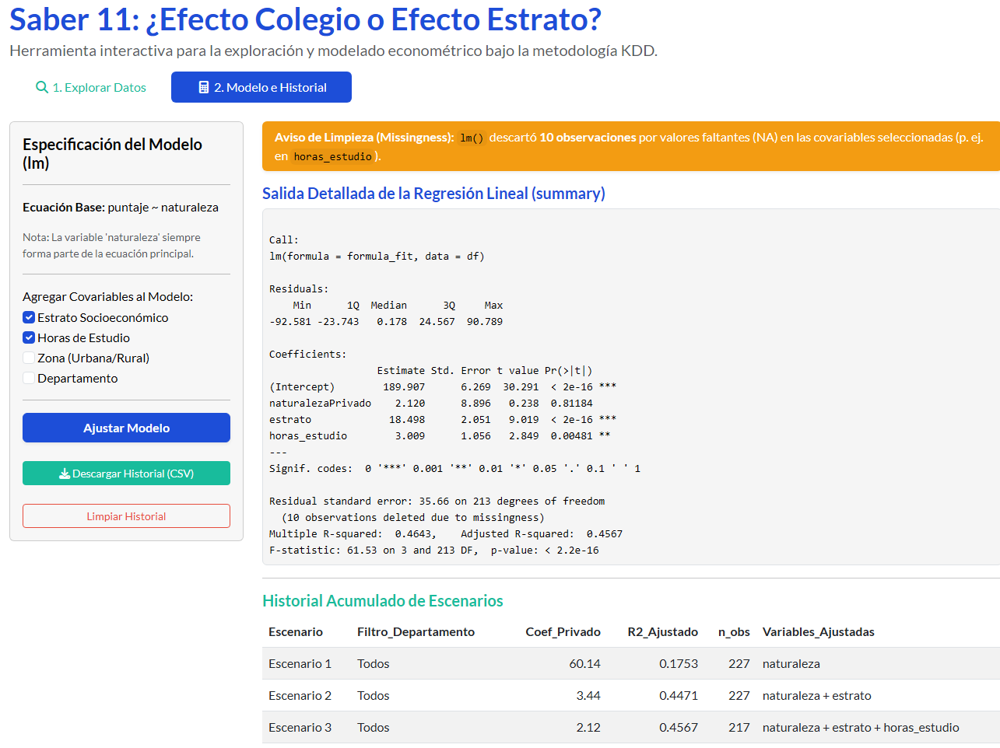
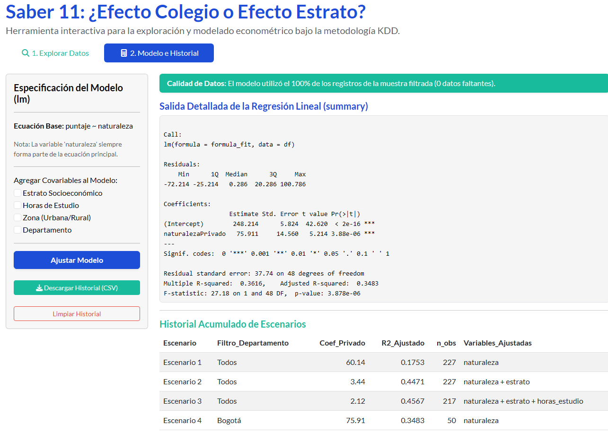
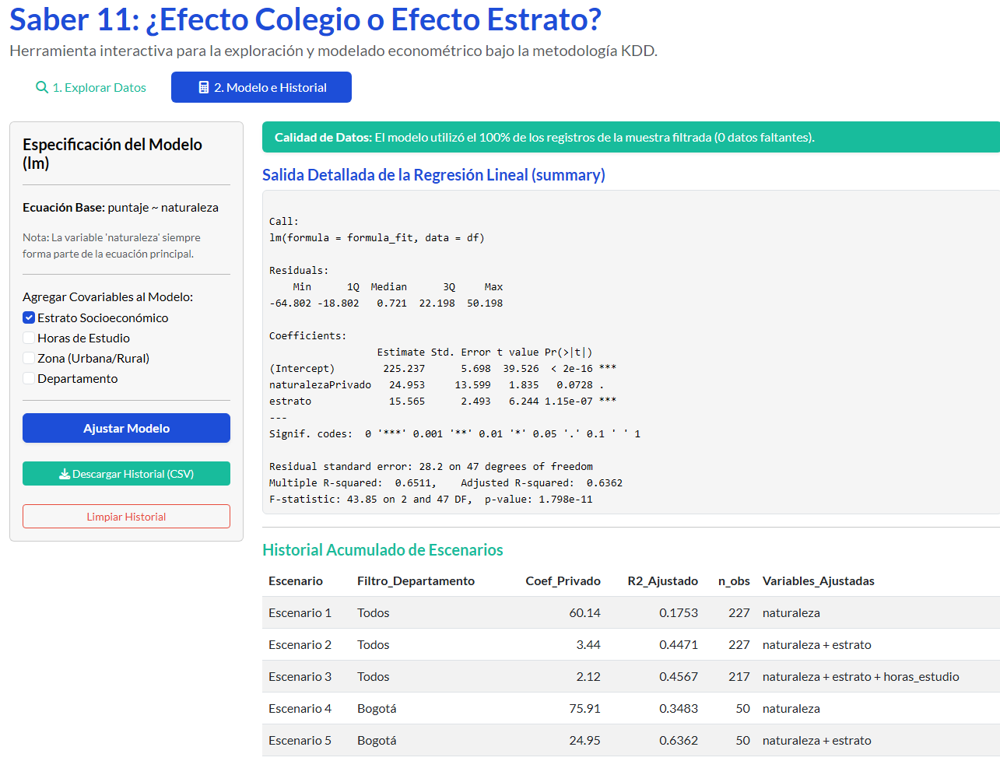

```{r setup, include=FALSE}
knitr::opts_chunk$set(echo = TRUE, message = FALSE, warning = FALSE)

# 1. Carga e instalación estandarizada de paquetes requeridos
paquetes   <- c("shiny", "bslib", "tidyverse", "DT", "knitr", "kableExtra")
instalados <- rownames(installed.packages())
pendientes <- setdiff(paquetes, instalados)
if (length(pendientes) > 0) install.packages(pendientes)

library(shiny)
library(bslib)
library(tidyverse)
library(DT)
library(knitr)
library(kableExtra)

```

# 1. Paso 0: Generación Reproducible de Datos (`saber11.csv`)


```{r paso0_generacion_datos, echo=TRUE}
if (!file.exists("saber11.csv")) {
  set.seed(1111)
  n <- 1500
  dp <- c("Bogotá", "Antioquia", "Valle del Cauca", "Boyacá", "Chocó")
  departamento <- sample(dp, n, TRUE, c(.30, .25, .20, .15, .10))
  p_rural <- c(.05, .25, .25, .40, .50)[match(departamento, dp)]
  zona <- ifelse(runif(n) < p_rural, "Rural", "Urbana")
  estrato <- ifelse(zona == "Rural", 
                    sample(1:3, n, TRUE, c(.6, .3, .1)),
                    sample(1:6, n, TRUE, c(.15, .30, .28, .15, .07, .05)))
  naturaleza <- ifelse(runif(n) < plogis(-3.2 + .75 * estrato), "Privado", "Oficial")
  horas_estudio <- round(pmax(0, rnorm(n, 5 + .5 * estrato, 2.5)), 1)
  puntaje <- round(200 + 14 * estrato + 12 * (naturaleza == "Privado") + 
                     4 * horas_estudio - 15 * (zona == "Rural") - 
                     20 * (departamento == "Chocó") + rnorm(n, 0, 30))
  horas_estudio[sample(n, 60)] <- NA  # 60 encuestas sin responder (MAR)
  
  datos_saber11 <- data.frame(departamento, zona, estrato, naturaleza, 
                              horas_estudio, puntaje, stringsAsFactors = FALSE)
  write.csv(datos_saber11, "saber11.csv", row.names = FALSE)
} else {
  datos_saber11 <- read.csv("saber11.csv", stringsAsFactors = FALSE)
}

# Verificación de existencia del archivo de datos
if (file.exists("saber11.csv")) {
  datos_check <- read.csv("saber11.csv")
  cat("Registros totales (n):", nrow(datos_check), "\n")
  cat("Mediana del puntaje global:", median(datos_check$puntaje), "puntos\n")
} else {
  cat("El dataset no se ha generado aún. Se creará automáticamente al iniciar la app.\n")
}

```

---

# 2. Aplicación Web Interactiva (Etapas 1 y 2)


A continuación, se presentan dos mecanismos reproducibles para integrar y abrir el archivo externo `app.R`, uno por ventana modal y otro directamente embebido en la página. 


```{r lanzador_modal, echo=TRUE}
# # Botón para lanzar la app en ventana emergente
# actionButton(
#   "btn_abrir_modal", 
#   "Abrir Aplicación Saber 11 (Ventana Modal)", 
#   class = "btn-primary btn-lg w-100"
# )
# 
# observeEvent(input$btn_abrir_modal, {
#   showModal(modalDialog(
#     title = "Aplicación Web Interactiva: Saber 11 - ¿Colegio o Estrato?",
#     size = "xl",
#     easyClose = TRUE,
#     footer = modalButton("Cerrar Ventana"),
#     
#     # Invocación directa del archivo externo app.R
#     shinyAppFile("app.R", options = list(width = "100%", height = "750px"))
#   ))
# })
```

```{r visualizador_app, echo=FALSE, out.width="100%"}
# Permite visualizar la app directamente embebida sin necesidad de botones modal
knitr::include_app("https://c2d31m-laura-mart0nez.shinyapps.io/mi_taller_saber11/", height = "750px")
```


```{r boton_despliegue_shiny, echo=FALSE, results='asis'}
# Generación de botón estético interactivo mediante HTML/Bootstrap
cat('
<div style="text-align: center; margin: 30px 0; padding: 20px; background-color: #f8fafc; border: 1px solid #e2e8f0; border-radius: 12px; box-shadow: 0 2px 4px rgba(0,0,0,0.05);">
  <h4 style="color: #1e293b; font-weight: bold; margin-bottom: 12px;">Acceso a la Aplicación en Producción</h4>
  <p style="color: #64748b; margin-bottom: 20px;">Haga clic en el siguiente botón para interactuar con la herramienta analítica en vivo:</p>
  <a href="https://c2d31m-laura-mart0nez.shinyapps.io/mi_taller_saber11/" 
     target="_blank" 
     class="btn btn-primary btn-lg" 
     style="background-color: #1d4ed8; border-color: #1e40af; color: #ffffff; padding: 14px 32px; font-weight: bold; font-size: 1.1em; border-radius: 8px; text-decoration: none; display: inline-block; box-shadow: 0 4px 6px -1px rgba(29, 78, 216, 0.3);">
     🚀 Abrir Aplicación Saber 11 en shinyapps.io
  </a>
  <p style="margin-top: 15px; color: #94a3b8; font-size: 0.85em;">
    <em>URL oficial: https://c2d31m-laura-mart0nez.shinyapps.io/mi_taller_saber11/</em>
  </p>
</div>
')
```


---


```{r configuracion_capturas, echo=TRUE, message=FALSE, warning=FALSE}
# 1. Verificación e instalación de paquetes para capturas automatizadas
paquetes_captura <- c("webshot2", "chromote", "knitr", "kableExtra", "tidyverse", "shinytest2")
pendientes <- setdiff(paquetes_captura, installed.packages()[, "Package"])
if (length(pendientes) > 0) install.packages(pendientes)

library(webshot2)
library(knitr)
library(kableExtra)
library(tidyverse)
library(shinytest2)

# 2. Generar captura automática de la aplicación app.R
# appshot() ejecuta la app en segundo plano y toma la foto del estado inicial
if (file.exists("app.R")) {
  app <- AppDriver$new(
    app = "app.R",
    name = "saber11_kdd_test", 
    height = 900, 
    width = 1300 # Se amplía ligeramente el ancho para que la salida de lm() no se trunque
  )
}
```

```{r automatizacion_capturas_shiny, echo=TRUE, message=FALSE, warning=FALSE}
# ------------------------------------------------------------------------------
# CAMBIO A LA PESTAÑA 2: "2. Modelo e Historial"
# Seleccionamos la pestaña del modelo mediante el selector CSS del tabset
# ------------------------------------------------------------------------------
app$click(selector = "a[data-value='2. Modelo e Historial']")
app$wait_for_idle(timeout = 2000)

# ------------------------------------------------------------------------------
# ESCENARIO 1 (Pregunta 1): Solo naturaleza, sin covariables
# ------------------------------------------------------------------------------
app$get_screenshot("captura_pregunta1.png")

# ------------------------------------------------------------------------------
# ESCENARIO 2 (Pregunta 2): + Estrato socioeconómico
# ------------------------------------------------------------------------------
app$set_inputs(covariables = "estrato")
app$click("btn_ajustar")
app$wait_for_idle(timeout = 3000)
app$get_screenshot("captura_pregunta2.png")

# ------------------------------------------------------------------------------
# ESCENARIO 3 (Pregunta 3): + Horas de estudio (Genera aviso de NAs)
# ------------------------------------------------------------------------------
app$set_inputs(covariables = c("estrato", "horas_estudio"))
app$click("btn_ajustar")
app$wait_for_idle(timeout = 3000)
app$get_screenshot("captura_pregunta3.png")

# ------------------------------------------------------------------------------
# ESCENARIO 4A (Pregunta 4 - Parte 1): Filtro Bogotá (Solo Naturaleza)
# ------------------------------------------------------------------------------
# 1. Filtro por Bogotá y limpia cualquier covariable previa (deja solo naturaleza)
app$set_inputs(filtro_depto = "Bogotá") 
app$set_inputs(covariables = character(0)) 
app$click("btn_ajustar")
app$wait_for_idle(timeout = 3000)
app$get_screenshot("captura_pregunta4a_bogota_naturaleza.png")

# ------------------------------------------------------------------------------
# ESCENARIO 4B (Pregunta 4 - Parte 2): Filtro Bogotá (Naturaleza + Horas de Estudio)
# ------------------------------------------------------------------------------
# 2. Activa únicamente la covariable de horas de estudio mantención del filtro de Bogotá
app$set_inputs(covariables = "estrato")
app$click("btn_ajustar")
app$wait_for_idle(timeout = 3000)
app$get_screenshot("captura_pregunta4b_bogota_estrato.png")


# Finalizar la sesión interactiva del navegador
app$stop()
```


## 1. ¿Cuánto más obtienen los privados? (Solo naturaleza, sin filtros)

Sin controlar por otras variables, los estudiantes de colegios privados obtienen en promedio 60.14 puntos más que los de colegios oficiales. No obstante, este modelo explica solo el 17.53% de la variabilidad de los puntajes (\(R^2_{adj} = 0.1753\)).

```{r mostrar_p1, echo=FALSE, fig.cap="Captura real tomada por shinytest2 - Escenario 1", out.width="90%"}

```

## 2. ¿Y a igual estrato? (Agrega estrato)

Al controlar por el estrato socioeconómico, la ventaja aparente del colegio privado se reduce drásticamente a solo 3.44 puntos. La capacidad explicativa del modelo asciende al 44.71% (\(R^2_{adj} = 0.4471\)).

```{r mostrar_p2, echo=FALSE, fig.cap="Captura real tomada por shinytest2 - Escenario 2", out.width="90%"}

```

## 3. ¿Por qué cambia \(n\)? (Agrega horas y lee el aviso)

El tamaño muestral se reduce de 227 a 217 observaciones (\(n=217\)) debido a la presencia de datos faltantes (*missingness*) en la variable *horas de estudio* (10 registros con `NA`). La función `lm()` ejecuta eliminación por lista (*listwise deletion*), descartando automáticamente las filas incompletas.

```{r mostrar_p3, echo=FALSE, fig.cap="Captura real tomada por shinytest2 - Escenario 3", out.width="90%"}

```

## 4. ¿Pasa lo mismo en Bogotá? (Filtra y repite 1 y 2)

En Bogotá, la brecha inicial sin controlar es de 75.91 puntos a favor del sector privado (\(R^2_{adj} = 0.3483, n=50\)). Al agregar la covariable de estrato, la ventaja del colegio privado disminuye a 24.95 puntos (\(R^2_{adj} = 0.6362\)), confirmando que el estrato absorbe la mayor parte del efecto, aunque en la capital la brecha residual se mantiene mayor.

```{r mostrar_p4a, echo=FALSE, fig.cap="Captura real tomada por shinytest2 - Bogotá (Solo Naturaleza)", out.width="90%"}


```


```{r mostrar_p4b, echo=FALSE, fig.cap="Captura real tomada por shinytest2 - Bogotá (Naturaleza + Estrato)", out.width="90%"}


```


## Respuesta para la Secretaría de Educación

> ¿la ventaja es del colegio o del estrato? 

> La ventaja en el puntaje Saber 11 no pertenece a la naturaleza del colegio privado sino al estrato socioeconómico de los estudiantes, el cual captura la capacidad económica y el capital cultural del hogar.

> ¿Qué no puede afirmar este modelo?

> Este modelo no puede afirmar relaciones de causalidad ni atribuir la brecha a la calidad de la enseñanza, debido al sesgo de selección de los estudiantes y a la omisión de factores clave como el nivel educativo de los padres.


